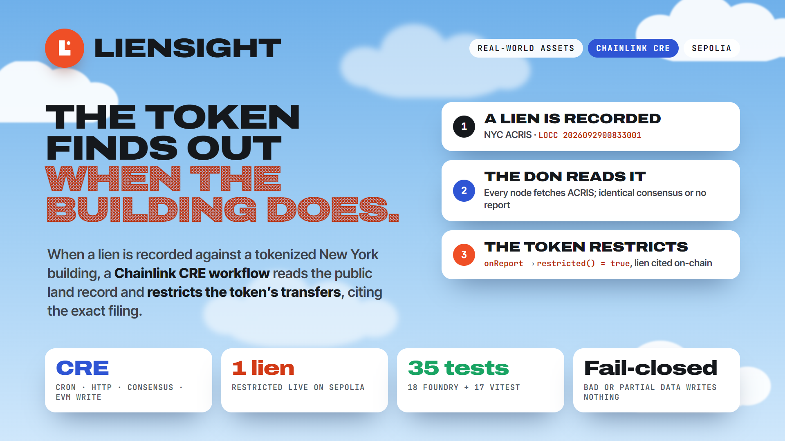
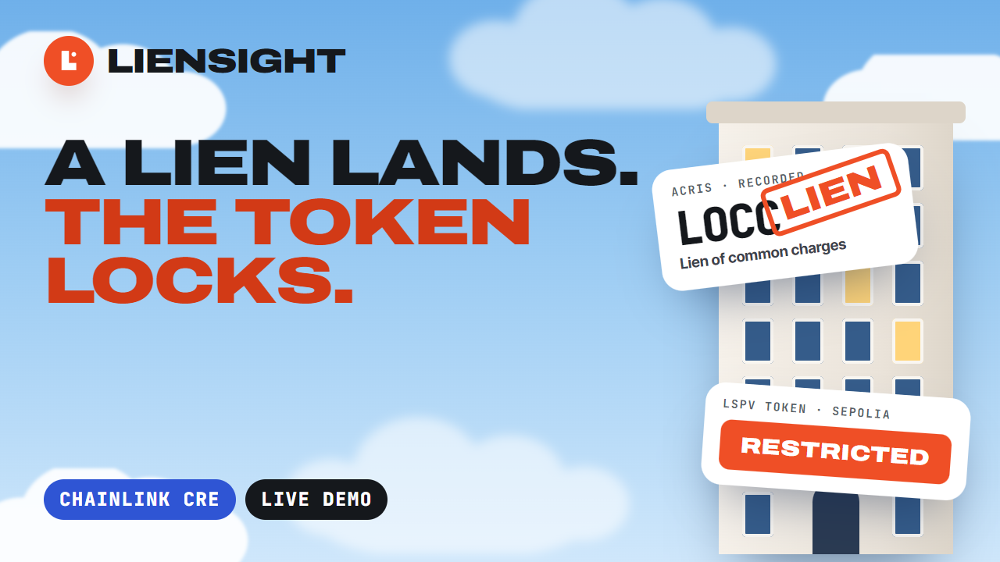
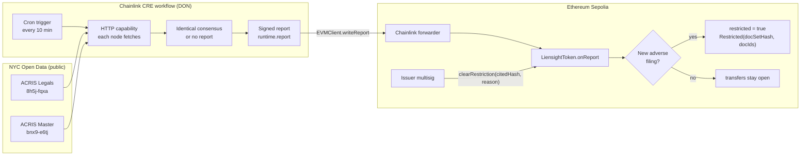

<p align="center">
  
</p>

<h1 align="center">Liensight</h1>

<p align="center">
  <b>When a lien is recorded against a tokenized building, the token finds out.</b><br />
  A Chainlink CRE workflow reads New York City’s public land records and restricts a real-estate token’s transfers, citing the exact filing.
</p>

<p align="center">
  <b>BLI Legal Tech Hackathon 2</b> (DoraHacks) · Track: <b>Real-world assets</b> · Bounty: <b>Chainlink, Best workflow with CRE</b>
</p>

<p align="center">
  <a href="LIVE_SITE_URL"><b>Live site</b></a> ·
  <a href="VIDEO_URL"><b>3-minute pitch &amp; live demo</b></a> ·
  <a href="https://sepolia.etherscan.io/address/0xf813c584Fe5e8c86A3F6c7265923CeE0850604aE#events"><b>Token on Etherscan</b></a> ·
  <a href="#user-guide"><b>User guide</b></a>
</p>

---

## Contents

- [Pitch video](#pitch-video)
- [The problem](#the-problem)
- [The solution](#the-solution)
- [Why Chainlink CRE](#why-chainlink-cre)
- [How the workflow works](#how-the-workflow-works)
- [Architecture](#architecture)
- [Smart contract](#smart-contract)
- [Live proof on Sepolia](#live-proof-on-sepolia)
- [User guide](#user-guide)
  - [For judges: verify in five minutes](#for-judges-verify-in-five-minutes)
  - [Using the website](#using-the-website)
  - [For developers: reproduce everything](#for-developers-reproduce-everything)
  - [Troubleshooting](#troubleshooting)
- [Repository layout](#repository-layout)
- [Tech stack](#tech-stack)
- [Security](#security)
- [Honest limits](#honest-limits)
- [Roadmap](#roadmap)
- [Brand assets](#brand-assets)

---

## Pitch video

<p align="center">
  <a href="VIDEO_URL"></a>
</p>

Three minutes: the problem, the CRE workflow, and a live demo built from **real screen recordings** (the checker reading ACRIS, the `cre workflow simulate --broadcast` run, the transaction and events on Etherscan, and `cast` reading the token). The video source is in [`pitch/`](pitch/), built with HyperFrames.

---

## The problem

Real estate is being tokenized. Shares in a single building, held through an SPV, can trade on-chain around the clock.

But the law keeps moving off-chain. A **tax lien, a federal lien, a judgment or unpaid common charges** can be recorded against the property at any time. In New York City those filings land in **ACRIS**, the city’s public land-records system.

Today the token has no idea. Someone has to remember to check the county record, and until they do, shares in an encumbered building keep changing hands. The chain never looks.

## The solution

Liensight connects the token to the public record:

1. A **Chainlink CRE workflow** runs on a schedule for one property (its NYC borough-block-lot, BBL).
2. Every node in the decentralized oracle network **independently reads ACRIS** through NYC Open Data.
3. The nodes must agree on the **exact same document set**, or nothing is written.
4. The workflow sends a **signed report** to `LiensightToken` on Sepolia.
5. If there is a new adverse filing, the token **restricts transfers** and cites the filing’s document ID on-chain.
6. Only the **issuer multisig** can clear the restriction, and only by naming the exact liens it reviewed.

`LiensightToken` is SPV **equity**, not title to the property. Liensight is an **early-warning signal from a public record**, not a title search and not legal advice.

**Adverse document types** (verified against ACRIS Document Control Codes, dataset `7isb-wh4c`): `FL`, `FTL`, `NTXL`, `TLS`, `LOCC`, `JUDG`. Discharge types (`RFL`, `RFTL`, `DTL`, `DPFTL`, `WFL`, `RTXL`, `TOLCC`, `PWFL`, `PRFL`) only emit `ClearSuggested`; they never clear on their own. The map is versioned in [`workflow/src/codeMap.json`](workflow/src/codeMap.json) and its hash is stored on the token.

---

## Why Chainlink CRE

A lien lives in a **government database**, and a smart contract can’t call an API. The fix needs three things a contract can’t do alone:

| Need | How CRE provides it in Liensight |
|---|---|
| **Read an external API** | The HTTP capability lets every node query NYC Open Data (ACRIS) directly. |
| **Agree on what it says** | `consensusIdenticalAggregation` requires byte-identical results from the nodes; a disagreement produces no report. |
| **Act on-chain, verifiably** | `runtime.report` signs the result and `EVMClient.writeReport` delivers it through the Chainlink forwarder to the token’s `onReport`. |

No single server or operator decides what the chain sees, and every restriction cites a document ID anyone can look up on ACRIS.

---

## How the workflow works

<p align="center">
  
</p>

The whole workflow is [`workflow/workflow.ts`](workflow/workflow.ts) (73 lines) plus tested helpers in [`workflow/src/`](workflow/src/). It is TypeScript on `@chainlink/cre-sdk`, compiled to WebAssembly by the CRE CLI.

| Step | CRE primitive | What happens |
|---|---|---|
| **1. Trigger** | `CronCapability` with `"0 */10 * * * *"` | Runs every 10 minutes for the configured BBL. |
| **2. Fetch** | `HTTPClient.sendRequest` | Each node queries ACRIS Real Property **Legals** (`8h5j-fqxa`) for the lot’s document IDs, then **Master** (`bnx9-e6tj`) for their types, in chunks of 80. |
| **3. Fail closed** | `assertComplete`, `assertNonEmpty` | A non-200 response, a response hitting the 5,000-row limit, or zero documents throws, so **no report is written**. |
| **4. Canonicalize** | `canonicalDocs` | Documents present in both datasets, deduplicated and sorted, so every honest node produces identical bytes. |
| **5. Consensus** | `consensusIdenticalAggregation<string>()` | Nodes must return the identical document set. |
| **6. Classify** | `buildReport` + `codeMap.json` | Splits documents into adverse and discharge IDs and computes `docSetHash`. |
| **7. Report** | `runtime.report(prepareReportRequest(...))` | Signs `(propertyKey, docSetHash, adverseIds[], dischargeIds[])`, ABI-encoded. |
| **8. Write** | `EVMClient.writeReport` | Delivers through the forwarder to `LiensightToken.onReport`. |

---

## Architecture



---

## Smart contract

[`contracts/src/LiensightToken.sol`](contracts/src/LiensightToken.sol) is an OpenZeppelin ERC-20 with an issuer-governed transfer restriction (100 lines).

- **`onReport(metadata, report)`** accepts a report only from the configured forwarder, only if the workflow owner in the metadata matches `expectedWorkflowOwner`, and only for this token’s `propertyKey` (`keccak256("BBL:2-5789-1022")`).
- **Idempotent:** a report with the same `docSetHash` as the last one is ignored.
- **Restrict:** a never-before-seen adverse document sets `restricted = true`, stores `citedHash = keccak256(abi.encode(citedIds))` and emits `Restricted(docSetHash, docIds)`. A lien that was already reported never re-restricts after it is cleared.
- **`_update`** reverts every transfer with `TransferRestricted()` while restricted (minting excepted), including the issuer’s own.
- **`clearRestriction(reviewedCitedHash, reason)`** is issuer-only and reverts with `ReviewMismatch()` if new liens landed since the issuer’s review.
- **`setExpectedWorkflowOwner`** lets the issuer rotate from the simulator to a deployed workflow.

---

## Live proof on Sepolia

| What | Value |
|---|---|
| Token | [`0xf813c584Fe5e8c86A3F6c7265923CeE0850604aE`](https://sepolia.etherscan.io/address/0xf813c584Fe5e8c86A3F6c7265923CeE0850604aE) |
| Deploy tx | [`0xb27c9ed1…69c4d9`](https://sepolia.etherscan.io/tx/0xb27c9ed1891c763325412789f3d05e1d221584353186e80eb9ad31ea9769c4d9) |
| First restricting report | [`0xc0cc2382…bda85ab`](https://sepolia.etherscan.io/tx/0xc0cc238205a36246731feddba275b3df50b4c781f3958b8d4cab8a862bda85ab) |
| Report recorded in the demo video | [`0x5e301044…160d94`](https://sepolia.etherscan.io/tx/0x5e301044fbb77ae37e096d0752208fa19f6e0d23f8292a2bbc45217aff160d94) |
| Forwarder (CRE simulator) | `0x15fC6ae953E024d975e77382eEeC56A9101f9F88` |
| Property | Bronx BBL `2-5789-1022` |
| Cited filing | ACRIS `2026092900833001`, type `LOCC` (lien of common charges), recorded 2026-09-30 |
| State | `restricted() = true`; `codeMapHash()` = `0xf85b5521…4326faf3` |

Full CLI output is in [`docs/simulation-log.md`](docs/simulation-log.md).

---

## User guide

### For judges: verify in five minutes

No wallet, keys or installs needed for steps 1–3.

1. **See the lien in the public record.** Open the live site’s **Check a lot** page (or [`site/check.html`](site/check.html) locally, see below). Click **Bronx 2-5789-1022 · has a lien**. The page queries ACRIS live and shows *Transfers would be restricted: 1 adverse filing* (`LOCC 2026092900833001`). Click **Manhattan 1-905-1347 · clean** to see a lot with nothing adverse.
2. **See the report on-chain.** Open the [token’s events on Etherscan](https://sepolia.etherscan.io/address/0xf813c584Fe5e8c86A3F6c7265923CeE0850604aE#events). The `report(...)` call carries the document-set hash the nodes agreed on.
3. **See the restriction.** Open the site’s **Proof** page, which reads `restricted()` live from Sepolia.
4. **Optional, with Foundry installed**, ask the chain directly:
   ```bash
   RPC=https://ethereum-sepolia-rpc.publicnode.com
   TOKEN=0xf813c584Fe5e8c86A3F6c7265923CeE0850604aE
   cast call $TOKEN "restricted()(bool)" --rpc-url $RPC          # true
   cast call $TOKEN "citedHash()(bytes32)" --rpc-url $RPC        # 0xb87d…49f4
   # even the issuer cannot move shares: reverts with TransferRestricted() (0xe827105e)
   cast call $TOKEN "transfer(address,uint256)(bool)" 0x000000000000000000000000000000000000dEaD 1 \
     --from 0xd51E7130B55f10595939f274cCB8c00b52C915b4 --rpc-url $RPC
   ```
   `citedHash` equals `keccak256(abi.encode([bytes32(2026092900833001)]))`, so the restriction provably cites that ACRIS document.

### Using the website

The site in [`site/`](site/) is static HTML, CSS and JavaScript. Run it locally with:

```bash
python -m http.server 5181 --directory site
# open http://localhost:5181
```

| Page | What it’s for |
|---|---|
| **Home** (`index.html`) | The story in one page. |
| **Check a lot** (`check.html`) | Enter any NYC borough, block and lot, then press **Check**. The page queries ACRIS live and applies the **same adverse map as the workflow**. It runs in your browser and writes nothing on-chain. |
| **Proof** (`proof.html`) | Reads the deployed token’s state live from Sepolia, with links to the transactions. |
| **Docs** (`docs.html`) | How the workflow, report and contract fit together; the document codes; run commands. |
| **Security** (`security.html`) | Threat model and the checks in `onReport`. |
| **Use cases, Roadmap, About** | Who it’s for, what’s next, who built it. |

To find a property’s BBL, search the address on [NYC’s ACRIS](https://a836-acris.nyc.gov/) or [NYC Open Data](https://data.cityofnewyork.us/).

### For developers: reproduce everything

#### Prerequisites

| Tool | Version used | Needed for |
|---|---|---|
| [Foundry](https://getfoundry.sh/) (`forge`, `cast`) | 1.5.1 | Contract tests, deploy, on-chain reads |
| Node.js + npm | 20+ | Workflow tests |
| [Chainlink CRE CLI](https://docs.chain.link/cre) (`cre`) | v1.2.0 | Simulating and broadcasting the workflow |
| Bun | installed by `npm i` in `workflow/` | The CRE CLI uses it to build the TypeScript workflow |
| Python 3 | any | Serving the site locally (optional) |

#### 1. Clone and install

```bash
git clone --recursive https://github.com/shane2512/LienSight.git liensight && cd liensight
# already cloned without --recursive?  git submodule update --init --recursive
cd workflow && npm i && cd ..
```

#### 2. Run the tests (35 total)

```bash
cd contracts && forge test     # 18 passed
cd ../workflow && npm test     # 17 passed (3 files)
```

They cover the restrict and clear logic, forwarder, owner and property checks, idempotent reports, the issuer-review hash, ACRIS URL building, canonicalization, fail-closed guards and report encoding.

#### 3. Simulate the CRE workflow (dry run, reads live ACRIS)

```bash
cre login                                   # once
export PATH="$PWD/workflow/node_modules/.bin:$PATH"   # puts bun on PATH
cre workflow simulate ./workflow -T staging-settings --non-interactive --trigger-index 0   # Bronx lot, has a LOCC
cre workflow simulate ./workflow -T clean-settings   --non-interactive --trigger-index 0   # Manhattan lot, clean
```

Expected: `ACRIS docs=14 adverse=2026092900833001:LOCC` for the Bronx lot and `ACRIS docs=12 adverse=none` for Manhattan. [`demo/replay.sh`](demo/replay.sh) runs both.

#### 4. Broadcast a real report to Sepolia

Writing on-chain needs a funded Sepolia key in `CRE_ETH_PRIVATE_KEY` in a local `.env` (git-ignored; never commit it):

```bash
cre workflow simulate ./workflow -T staging-settings --non-interactive --trigger-index 0 --broadcast
```

The log ends with `report written tx=0x…`. Open that hash on Etherscan.

#### 5. Deploy your own token (optional)

```bash
cd contracts
export FORWARDER=0x15fC6ae953E024d975e77382eEeC56A9101f9F88   # CRE simulator forwarder on Sepolia
export WORKFLOW_OWNER=0xaAaAaAaaAaAaAaaAaAAAAAAAAaaaAaAaAaaAaaAa  # the simulator's placeholder owner
export CODEMAP_HASH=0xf85b55218f5961096bde039896bb3b115179f44c76446ff88e22e3b94326faf3
export ISSUER=<your address>                                   # receives supply, can clear
forge script script/Deploy.s.sol --rpc-url https://ethereum-sepolia-rpc.publicnode.com \
  --account <keystore-name> --broadcast --gas-estimate-multiplier 800
```

Then put the printed address in `tokenAddress` in [`workflow/config.staging.json`](workflow/config.staging.json) and run step 4.

- **Code-map hash:** to recompute it after editing the map, run `cd workflow && npx bun -e "import {codeMapHash} from './src/classify'; import m from './src/codeMap.json'; console.log(codeMapHash(m))"`.
- **Different property:** to watch another property, change `bbl` in the config and the `BBL:` string in [`Deploy.s.sol`](contracts/script/Deploy.s.sol). They must match.

#### 6. Re-render the pitch video (optional)

The film is a [HyperFrames](https://hyperframes.heygen.com) project in [`pitch/`](pitch/):

```bash
cd pitch
npx hyperframes@0.8.216 preview --background   # Studio preview
npx hyperframes@0.8.216 render --output renders/liensight-pitch.mp4
```

Captions come from `python tools/captions.py` and the score from `python tools/score.py`.

### Troubleshooting

| Symptom | Fix |
|---|---|
| `cre workflow simulate` can’t find `bun` | Run `npm i` in `workflow/` and add `workflow/node_modules/.bin` to `PATH`. |
| Sepolia deploy runs out of gas | Sepolia charges far more for contract code than Foundry estimates; keep `--gas-estimate-multiplier 800`. |
| The simulation logs a report but the token doesn’t change | The report is for a different `propertyKey`, comes from an unexpected workflow owner, or repeats the last `docSetHash`; the token ignores all three by design. |
| The site’s Proof page says “read failed” | The public RPC is busy; refresh, or use the `cast call` commands above. |
| ACRIS returns nothing | Check the BBL. The workflow refuses to report on zero documents (fail closed). |

---

## Repository layout

```
contracts/          Foundry project: LiensightToken.sol, Deploy.s.sol, 18 tests
workflow/           CRE workflow: workflow.ts, main.ts, workflow.yaml, configs
  src/              acris.ts (URLs, canonicalization, fail-closed), classify.ts, report.ts, codeMap.json, 17 tests
site/               Website: landing, live checker, proof, docs, security, use cases, roadmap, about
docs/               simulation-log.md (CLI evidence), demo-recording-guide.md
pitch/              3-minute pitch video (HyperFrames): scenes, voice, captions, score, real recordings
assets/             Logo, YouTube thumbnail, README posters; sources in assets/src
demo/               replay.sh (re-runs both CRE simulations); index.html is the earlier site
project.yaml        CRE project settings (Sepolia RPCs)
```

## Tech stack

| Layer | Technology |
|---|---|
| Oracle and compute | **Chainlink CRE**: cron trigger, HTTP capability, identical consensus, EVM write |
| Workflow | TypeScript, `@chainlink/cre-sdk` (compiled to WebAssembly), Bun, viem, Zod |
| Workflow tests | Vitest |
| Contracts | Solidity 0.8.24, OpenZeppelin ERC-20, Foundry |
| Chain | Ethereum Sepolia; verification on Etherscan |
| Data | NYC Open Data (Socrata API): ACRIS Real Property Legals and Master |
| Website | Static HTML, CSS, JavaScript with GSAP |
| Pitch video | HyperFrames, GSAP, Fish Audio voice |

## Security

- **Shared forwarder:** the CRE forwarder is shared by all workflows, so `onReport` also checks the workflow owner from the report metadata and the property key.
- **Fail closed:** errors, truncated responses and zero documents produce no report, never a false “clean”.
- **Issuer review:** `clearRestriction` must name the `citedHash` the issuer reviewed; it reverts if new liens arrived since.
- **No re-restricting cleared liens:** `seenAdverse` stops a cleared lien from triggering again.
- **Review:** a pre-deployment security review found **1 critical and 5 important** issues, all fixed and covered by tests.
- **Privacy:** fixtures contain document IDs and types only, no party names.

## Honest limits

- **Testnet only.** The report was written with `cre workflow simulate --broadcast` through Chainlink’s simulator forwarder, not a deployed CRE workflow. Consensus ran in the local simulator, not on a live multi-node DON.
- **Demo token trusts the placeholder owner.** The simulator stamps reports with a public placeholder owner (`0xaaaa…aaaa`), so anyone using the simulator forwarder could report to this demo token. Production would call `setExpectedWorkflowOwner` with the deployed workflow’s owner and use the production forwarder.
- **Records lag.** ACRIS records filings days after the event. This is an early-warning signal, not a title search.
- **No lis pendens or foreclosure.** ACRIS has no document type for them (they are court and county-clerk filings), so they are out of scope.
- **One source.** Every node reads the same public API.
- **Not legal advice.** It flags public filings; it does not judge their legal effect.

## Roadmap

1. **Deployed workflow** on a live CRE DON, with the token rotated to its owner via `setExpectedWorkflowOwner`.
2. **Production forwarder** instead of the simulator’s.
3. **A second data source** (NYC Department of Finance) to cross-check ACRIS.
4. **Many properties per workflow**, and other counties with open land records.

## Brand assets

Everything is in [`assets/`](assets/) and re-renders with `python assets/src/render.py`.

| File | Use |
|---|---|
| [`liensight-logo-square.png`](assets/liensight-logo-square.png) | 1:1 logo with the wordmark below |
| [`liensight-mark.svg`](assets/liensight-mark.svg) / [`.png`](assets/liensight-mark.png) | Symbol only (avatars, favicons) |
| [`liensight-logo.png`](assets/liensight-logo.png) | Horizontal logo, transparent |
| [`youtube-thumbnail.png`](assets/youtube-thumbnail.png) | 1280×720 video thumbnail |
| [`poster-hero.png`](assets/poster-hero.png) | 16:9 README banner |
| [`poster-workflow-stack.png`](assets/poster-workflow-stack.png) | 16:9 workflow and tech stack |

Technology logos in [`assets/logos/`](assets/logos/) are the official marks (Simple Icons, Etherscan’s brand kit, the viem and Foundry projects), used only to show the stack.

<p align="center"></p>
