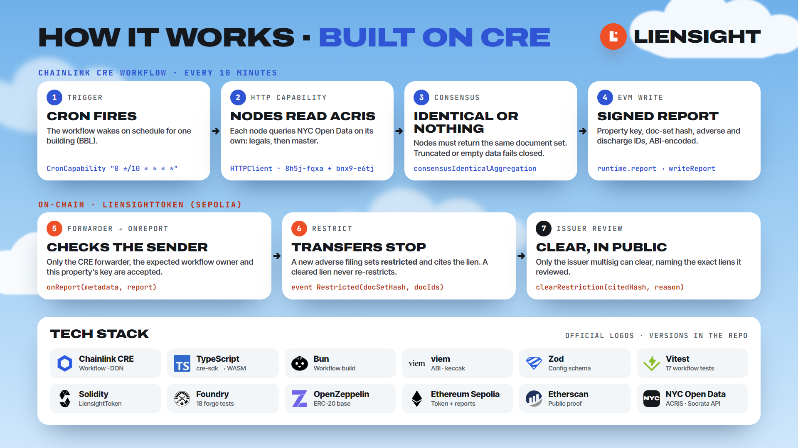
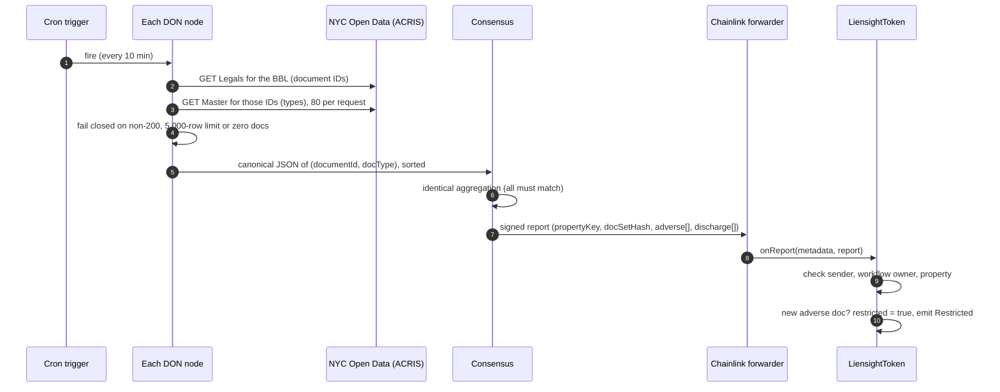

# Architecture

Liensight has three parts: a public data source, a Chainlink CRE workflow, and a token contract. The workflow carries facts from the first to the third, and nothing else can set the token’s restriction.

## Components

| Component | Where | Role |
|---|---|---|
| **ACRIS on NYC Open Data** | `data.cityofnewyork.us` (Socrata API) | The city’s land records. *Real Property Legals* (`8h5j-fqxa`) maps a lot to document IDs; *Real Property Master* (`bnx9-e6tj`) gives each document’s type. |
| **CRE workflow** | [`workflow/`](../workflow/) | Runs on a schedule on every node of a Chainlink DON. Fetches, agrees, signs and writes. |
| **Chainlink forwarder** | Sepolia `0x15fC…9F88` (simulator) | Verifies the DON’s signatures and calls the receiver with the report and its metadata. |
| **`LiensightToken`** | [`contracts/src/LiensightToken.sol`](../contracts/src/LiensightToken.sol) | ERC-20 SPV share token. Restricts transfers on a new adverse filing; only the issuer can clear. |
| **Issuer multisig** | set at deploy | Holds the supply, reviews restrictions, and clears them publicly. |
| **Website** | [`site/`](../site/), https://liensight.vercel.app | Explains, checks lots against ACRIS in the browser, and reads the token’s state. Not part of the trust path. |

## Data flow

## Trust boundaries

| Boundary | What is trusted | What protects it |
|---|---|---|
| ACRIS → nodes | The city’s published record | Every node fetches independently; responses must be complete and non-empty |
| Nodes → report | A quorum of the DON | Identical consensus: one differing node means no report |
| Report → token | The forwarder and the workflow owner | `onReport` checks `msg.sender`, the owner in the metadata, and the property key |
| Token → holders | The issuer, for clearing only | `clearRestriction` must name the `citedHash` it reviewed |

## Design decisions

| Decision | Why |
|---|---|
| **A DON for one public API** | No single server or operator decides what the chain sees, and every restriction cites a document anyone can look up. |
| **Identical, not median, consensus** | The output is a set of documents, not a number; byte-identical canonical JSON makes agreement exact. |
| **Fail closed** | A truncated or empty answer is more likely an outage or a wrong lot than a clean property, so nothing is written. |
| **Restrict automatically, clear by a person** | A lien appearing is a fact. Whether it still matters (paid, disputed, bonded) is a judgment, made publicly by an accountable issuer. |
| **Discharges only suggest a clear** | A release can be partial or for a different lien, so `ClearSuggested` flags it instead of lifting the restriction. |
| **Cleared liens never re-restrict** | `seenAdverse` remembers every reported document; only a genuinely new lien restricts again. |
| **Versioned, hashed type map** | Which ACRIS codes are adverse is a policy. It lives in `codeMap.json`, and its hash is fixed in the token. |
| **SPV equity, not title** | The token represents shares in a holding company. Liensight signals risk; it doesn’t settle ownership. |

## What runs where

| Concern | Runs in | File |
|---|---|---|
| Scheduling, HTTP, consensus, signing, delivery | CRE (DON) | [`workflow/workflow.ts`](../workflow/workflow.ts) |
| ACRIS URLs, canonicalization, fail-closed guards | CRE (DON) | [`workflow/src/acris.ts`](../workflow/src/acris.ts) |
| Classification | CRE (DON) | [`workflow/src/classify.ts`](../workflow/src/classify.ts), [`codeMap.json`](../workflow/src/codeMap.json) |
| Report encoding | CRE (DON) | [`workflow/src/report.ts`](../workflow/src/report.ts) |
| Restriction state and rules | Sepolia | [`contracts/src/LiensightToken.sol`](../contracts/src/LiensightToken.sol) |
| The same classification, for people | Browser | [`site/check.html`](../site/check.html) |

Next: [Workflow reference](workflow.md) · [Contract reference](contract.md)
